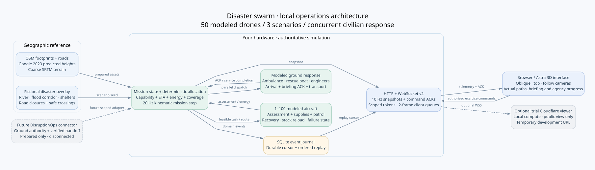

# Pune flood response simulator: implemented plan and next steps

The new operations experience runs independently inside `drone_swarm`. It combines a geographic 3D reference, 1–100 modeled aircraft, concurrent civilian ground response and a bounded bidirectional WebSocket. **DisruptionOps is unchanged and is not connected to this running demo.**

## Run locally

```powershell
.\.conda-drones\python.exe -m pip install -r requirements\requirements-ops.txt
.\scripts\run-operations.ps1 -Fleet 50 -Seed 42
```

Open `http://localhost:8787`. The existing prepared assets allow offline startup; the UI uses locally vendored Three.js. A direct localhost session receives the exercise operator token. Public tunnel sessions receive a view-only session. The private operator URL is stored in `.cache/operations/operator-url.txt`; do not commit that file.

To start a temporary public viewer while computing locally:

```powershell
.\scripts\run-operations.ps1 -Fleet 50 -Tunnel
```

The URL appears in `.cache/operations/tunnel.log`. Closing the runner stops its tunnel. Quick Tunnel URLs are temporary and change after restarting; they have no production uptime guarantee. See [Cloudflare Quick Tunnels](https://developers.cloudflare.com/tunnel/get-started/quick-tunnels/).

## Experience and geographic fidelity

The anchor is **18.6526632 N, 73.7624378 E**, with a roughly 1.2 km square reference area. The prepared map contains 1,175 OSM building footprints and 330 road ways. Heights now use 1,082 filtered Google Open Buildings 2023 predictions, 17 OSM floor-count estimates and 76 explicit fallback estimates. A 9×9 SRTM elevation grid sampled every 150 m provides 38 m of relative terrain relief. The scene grounds structures, roads, trees and actors on interpolated terrain.

This is a geographically grounded approximation. It does not reproduce Google satellite imagery, facade photographs, exact roof structures or surveyed building heights. Trees, materials, rooftop equipment and emergency facilities are procedural. The river and flood are an intentionally fictional scenario overlay, as requested. Radar terrain is coarse; the flood corridor is prescribed, not a hydraulic simulation. AGL coordinates are visualized above local terrain; the mission planner does not perform terrain-aware flight dynamics.

Data preparation is separate from runtime:

```powershell
.\.conda-drones\python.exe tools\prepare_operations_terrain.py
# Optional tooling dependencies for regenerating predicted heights:
.\.conda-drones\python.exe -m pip install -r requirements\requirements-geodata.txt
.\.conda-drones\python.exe tools\prepare_operations_heights.py
.\.conda-drones\python.exe tools\prepare_operations_map.py --offline
```

The height downloader reads bounded GeoTIFF windows rather than downloading entire regional files. The first preparation retrieved about 8.3 MiB. Dataset attribution and prediction limitations are recorded in the assets. Sources: [OSM attribution and license](https://www.openstreetmap.org/copyright), [Google Open Buildings 2.5D](https://sites.research.google/gr/open-buildings/temporal/), [SRTM dataset](https://www.opentopodata.org/datasets/srtm/).

GPT-6 Astra implemented the new 3D view and Apple-inspired UI: system fonts, light panels, restrained colors, legible labels, natural sunlight, oblique/top/follow cameras and internally scrolling fleet lists. Reference video frames from 1:10 onward are saved in `docs/reference/video-frames/`. Their map-first layout, capability colors, actual numbered route points and playback controls inform this civilian interface. There are no invented formation animations or aircraft-control claims.

## Scenarios and decisions

| Scenario | Drone action | Concurrent agency action | Completion condition |
|---|---|---|---|
| Rooftop flood rescue | Reach an actual modeled roof near the synthetic river; assess and supply eligible food/first aid | River-following rescue boat and any eligible medical response | Required agency work and evacuation capacity trips complete |
| Urgent medical supply | Match first-aid/medical payload and energy feasibility before comparing ETA; transmit assessment | Ambulance dispatched independently; other emergencies compete for scarce teams | Agency service finishes; a supply drop alone cannot resolve the incident |
| Blocked bridge evacuation | Survey the damaged crossing and brief responders | Engineering and rescue requirements tracked separately; closed road edges excluded | Every required agency action finishes |

`New scenario` changes the case and random seed. Explicit selection supports reproducible exercises. Incident roof selection and people counts vary with the seed.

The state flow is detection → dispatch → drone assessment/briefing → ground arrival → briefing acknowledgment → drone recall or retasking → agency service → resolution. Drone and ground dispatch proceed concurrently. A ground team becoming available triggers another allocation pass. Merely marking a team `on_site` does not imply a briefing acknowledgment. A supply drop remains a partial action.

Each modeled aircraft bids using eligibility, payload stock, route feasibility and an illustrative energy budget including outbound work, recovery and reserve. Feasible compatible payloads are preferred over unsuitable nearer aircraft. Reconnaissance can continue if the necessary supply is unavailable. Payload is consumed and reloads at base. Coverage cells retain observation time; unique claims prevent routine duplicate patrol assignments.

Road vehicles use a road graph. Flooded edges and damaged crossings are excluded; designated simulated safe crossings remain traversable. Boats follow the river and modeled flooded corridor, with capacity-limited evacuation trips to safe shore. Responders do not teleport to incidents. These routes and service times are simplified demonstrations rather than validated emergency routing or boat dynamics.

## Failure behavior

| Condition | Current response | Remaining limit |
|---|---|---|
| Confirmed injected crash | Aircraft remains failed; unfinished task can be reassigned | No mechanical failure physics or debris avoidance |
| Injected link loss | Retain task uncertainty; do not equate silence with verified completion | A true radio partition/consensus protocol is not implemented |
| Insufficient energy | Reject assignment or return using reserve estimate | Wind, pack aging, landing queues and measured consumption are not calibrated |
| Supply unavailable | Reconnaissance fallback and unmet need retained; spent supply reloads at base | No real cargo mass/medical treatment model |
| No eligible responder or disconnected road route | Keep requirement outstanding; retry as resources become available | No guarantee all arbitrary emergencies can be resolved |
| Ground arrival before aerial briefing | Handoff acknowledgment gate preserves drone assignment | Local simulated responders can acknowledge automatically once conditions pass |
| Premature or stale handoff | Reject acknowledgment or defer recall | Future external adapter needs approved taxonomy and live authority |
| Duplicate command | Return cached acknowledgment; avoid repeated reset/fault | Cache lasts for server process and 2,000 entries, not across restarts |
| Slow/disconnected viewer | Coalesce bounded telemetry; display stale state and reconnect | Frame delivery is not guaranteed; use durable event replay |
| Scenario reset during congestion | Include world in reset snapshots until delivery succeeds | Simulation itself is not persisted across server restarts |

## Components and timing

`swarm_ops/engine.py` owns domain state and deterministic decisions. `swarm_ops/server.py` owns HTTP, scoped controls, snapshots, acknowledgments, replay and per-client backpressure. `web/ops/operations.*` owns 3D rendering and the UI. The server steps the mission approximately every 50 ms; telemetry defaults to 10 Hz, while browser rendering/interpolation follows its animation loop.



Editable Graphviz source: `operations-architecture.dot`. A PNG rendering is also included.

This implementation uses **one authoritative local simulation process**, which reconciles feasible aircraft bids. It is not a decentralized CBBA deployment, a radio mesh, Gazebo or a replacement for PX4 feedback loops. The repository's existing PyBullet exercise remains separate. No LLM is required to run the new mission decisions.

The local WebSocket is a visualization and exercise API. A future physical fleet should instead execute onboard state estimation, controllers and failsafes independently, use a flight-qualified local planner, exchange expiring trajectory intent, and replicate mission leases with partition-safe ownership. A cloud/UI outage must not interrupt onboard safety. See the existing research and Graphviz material in `docs/research/100-drone-disaster-response/`.

## Validation and next integration step

Run the local suites:

```powershell
.\.conda-drones\python.exe -m unittest discover -s tests -p "test_*.py" -v
.\.conda-drones\python.exe -m unittest discover -s tests -p 'test_disruptionops_*.py' -v
.\.conda-drones\python.exe tests/operations_acceptance.py
# Optional browser acceptance tooling:
npm install --prefix .tools/browser-check playwright
node tests/operations-browser.cjs
```

Transport tests use actual localhost HTTP/WebSockets, including operator/viewer separation, malformed and non-finite input, stale runs, replay, duplicate commands, oversized messages, command throttling and slow-client reset metadata. The optional connector tests use only local HTTP stubs and a copied unmounted backend proposal. No production resources are dispatched.

The next integration step is review of `disruptionops-integration.md` and the proposed connector contract against a separate demo database. DisruptionOps should remain the authority for ground agencies; swarm telemetry should supply observations and briefings. Its current medical/crossing taxonomy gaps need explicit agreement before activation. The adapter is prepared but deliberately not wired into this running server.

Latest measured results and limitations are recorded in `validation.md`. Dense 90-airborne stress occasionally exceeds the 100 ms telemetry budget; no hard real-time flight-control guarantee is claimed.

For stronger flight fidelity, next add a transport adapter to PX4 SITL/Gazebo, replay identical scenario events, and validate flight paths, battery estimation, link degradation and safety independently of the 3D renderer. An exact textured locality requires licensed 3D imagery/mesh data or a surveyed/photogrammetric asset set; a Google Maps URL alone cannot supply that geometry.
