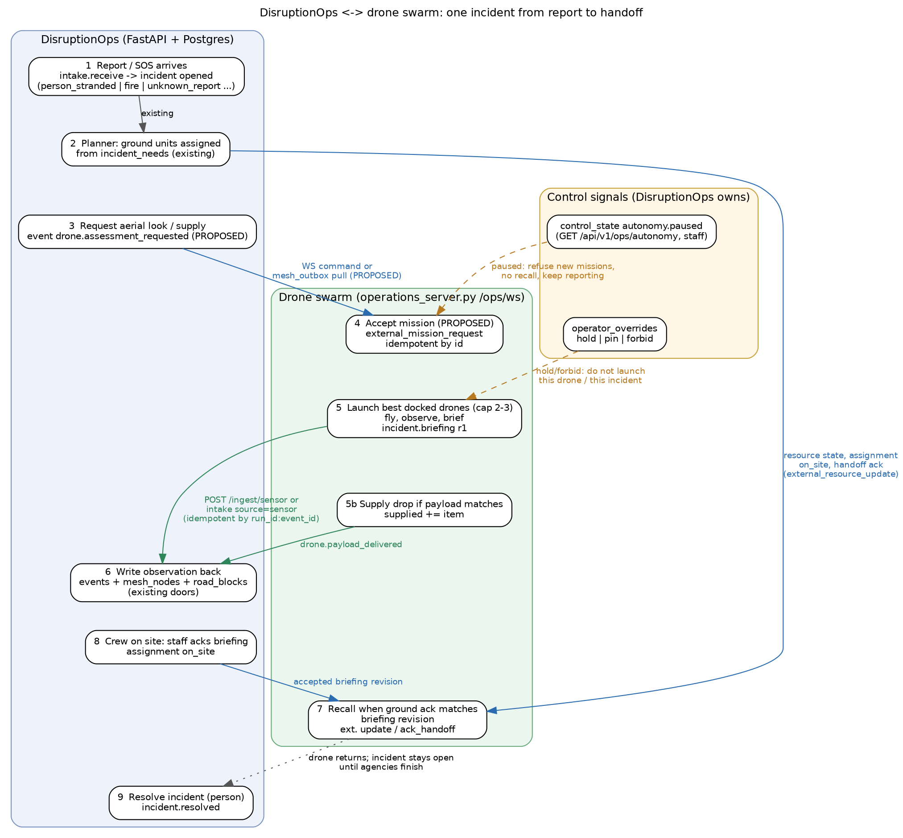

# How DisruptionOps calls the swarm (and how the swarm answers)

Reference: DisruptionOps `bd21179` (`D:\drone_research_reference\DisruptionOps-latest`, 29 migrations). The older clone at `4e87ade` is stale. API files are unchanged between the two; migration 029 and a new scenario are the only relevant changes.

Status on 2026-10-10: the swarm side of the **existing** interface is real and tested locally. Everything marked **PROPOSED** below does not exist yet. Nothing here has been run against a DisruptionOps database. Read `disruptionops-migrations.md` first for the table meanings.

## 0. Update (backend landed): the swarm is an agency, DisruptionOps is the orchestrator

Section 3 below was written as a proposal. Most of it now exists in the swarm. Where this section and section 3 disagree, this section is correct.

| Need | Implemented command or field | Auth |
|---|---|---|
| DisruptionOps asks the swarm for help (SOS, assess, supply, overwatch) | `agency_request` `{request_id, kind, position, category, people, needs, priority, requested_by, sim_run_id?}` | `OPS_INTEGRATION_TOKEN` |
| Swarm answers | ack `result` `{request_id, accepted, reason, incident_id, merged, eta_s, assigned_drones[], plan[], position, source}`; repeat of a `request_id` returns the stored decision with `duplicate: true` | same |
| Swarm asks DisruptionOps for ground units | event `status:"resource_request"` with `data {request_id, needed_kind, qty, urgency, position, rationale, briefing_revision}` plus a `resource_request` signal to `orchestrator` | read-only stream |
| DisruptionOps feeds back real ground state | `external_resource_update` (unchanged, section 5) | integration token |
| Follow what the swarm does | `GET /ops/events` and snapshot `events[].status`: accepted, declined, launched, on_scene, briefing, resource_request, resource_assigned, supply_delivered, ground_arrived, retasked, recalled, handed_over, completed | none (view-only ok) |
| Pause from DisruptionOps | **not implemented**: there is no `external_autonomy` command yet (section 6 stays a requirement). Local `pause` is an operator action. | |

Real exchange (fleet 5, `dock_fire`, captured 2026-10-10 on a private test port). Request:

```json
{"type":"command","id":"dops-1","expected_run_id":"<run>","action":"agency_request",
 "payload":{"request_id":"dops-req-7","kind":"sos","position":[190,-128],"category":"trapped","people":3,
            "needs":["rescue"],"priority":5,"requested_by":"disruptionops:incident-uuid"}}
```

Ack result:

```json
{"ok":true,"action":"agency_request","request_id":"dops-req-7","accepted":true,"reason":"accepted; aircraft queued",
 "incident_id":"I007","merged":false,"eta_s":null,"assigned_drones":[],
 "plan":["queued: next aircraft launches when one of 3 airborne is back at its dock",
         "request 1x rescue from orchestrator",
         "hand the scene over to the first ground crew, then return to dock"],
 "position":[190.0225,-128.5525,0.0],"source":"orchestrator"}
```

Swarm to orchestrator, taken from a real `random_incident` of category medical (incident I005):

```json
{"id":32,"t":106.11,"kind":"resource_request","from_type":"incident","from_id":"I005","to_ids":["orchestrator"],
 "incident_id":"I005","text":"Request 1x ambulance: initial report: medical, 1 people."}
```

The orchestrator (DisruptionOps) should answer by assigning a unit; the swarm sees the answer either as `external_resource_update` (resource `state: "enroute"`, `incident_id`) or, standalone, from its local mock orchestrator, which emits `ground_dispatch` (see `implementation/FRIEND-WEBSOCKET-HANDOFF.md` section A.4 for the full real payloads).

How a DisruptionOps connector should act on it:

1. Map each swarm `resource_request` to a DisruptionOps need on the incident whose `external_id` it holds. The need's capability comes from the category (migrations doc, section 3), the kind from `needed_kind` (`ambulance` -> `medical_transport`, `fire_engine` -> `fire_suppression`, `rescue` -> `search_rescue`/`water_rescue`).
2. Let the CP-SAT planner choose the unit. Do not let the connector pick units itself.
3. Send the chosen assignment back with `external_resource_update` using the real `PC-*` id and its state.
4. Mirror the swarm's status events into `events` rows as in section 4 (kinds `drone.*`, actor `sensor:drone-swarm`).
5. Call `agency_request` for a DisruptionOps incident the swarm has not seen (kind `sos` for a person in danger, `assess` for `unknown_report`, `supply` for `supply_shortage`). The swarm may decline; record the `reason` on the incident.

Framing consequence for `pol-8` (clause "request_mutual_aid"): an `agency_request` is a request to another organisation, so DisruptionOps should route it through the person-approval path unless the commissioner has delegated it.

## 1. Who owns what

| Concern | Owner | Rule |
|---|---|---|
| Incidents, ground units, assignments, audit log, emergency stop, overrides | DisruptionOps | The swarm never writes its tables directly (migration 014: the API is the only door). |
| Drone positions, battery, flight paths, dock launches, coverage, briefings, payloads | Swarm | Simulated. The `simulation_only` flag stays visible to every consumer. |
| "Is the incident resolved" | A person, in DisruptionOps | A drone arriving or dropping supplies never resolves an incident. |
| Ground vs drone-first policy | DisruptionOps asks, swarm executes | The swarm reports facts; it does not dispatch ambulances. |

There is already an older swarm listener inside DisruptionOps (`backend/app/drone/swarm.py`). It is a **read-only client of the old PyBullet feed** (`init`/`frame`/`log` messages, default path `/ws`). It sends nothing back, and it ignores `snapshot` messages (verified in its `handle()` function). It cannot talk to `/ops/ws`. Replace or disable it (`DRONE_SWARM=0`) when the new connector is added; do not run both against one incident stream.

## 2. The swarm's current interface (exists today)

Base: `http://localhost:8787` (loopback by default; public viewers via a Cloudflare tunnel are read-only). Protocol string `disruptionops.swarm.v2`, snapshot `schema_version` 2. Source: `swarm_ops/server.py`, `docs/implementation/websocket-protocol.md`.

### HTTP

| Method, path | Auth | Returns |
|---|---|---|
| `GET /health` | none | `{"ok":true,"protocol":"disruptionops.swarm.v2","simulation_only":true,"clients":N,"integration":false}` |
| `GET /ops/state` | none | Full snapshot (same object as WS `state`, includes `world`). Poll-friendly. |
| `GET /ops/events?after=<cursor>&limit=<1..500>` | none | `{"events":[{"cursor":12,"run_id":"...","id":"<run_id>:7","time":41.2,"kind":"incident","message":"...","incident_id":"I001"}],"next_cursor":12}` Durable (SQLite). |
| `GET /ops/session` | none; token only if the request is loopback to localhost with no forwarding headers | `{"control_token":"...","can_control":true,"simulation_only":true}` or `{"can_control":false,"simulation_only":true}` |

### WebSocket `ws://localhost:8787/ops/ws?token=<token>`

Server sends `{"type":"snapshot","protocol":"disruptionops.swarm.v2","seq":120,"server_time":1791590400.0,"state":{...}}` about 10 times a second. `state.world` is present only on the first packet and when `run_id` changes. Browser origin must match host.

Client sends commands:

```json
{"type":"command","id":"6f1c...-uuid","expected_run_id":"<run_id>","action":"scenario","payload":{"id":"dock_fire","seed":42}}
```

Reply:

```json
{"type":"ack","id":"6f1c...-uuid","ok":true,"result":{"ok":true,"action":"scenario","run_id":"<new run id>","revision":1}}
```

Rejected: `{"type":"ack","id":"...","ok":false,"error":"Operator authorization required"}`.

| Action | Payload | Token needed |
|---|---|---|
| `scenario` | `{"id":"rooftop_flood\|medical_supply\|blocked_bridge\|dock_fire","seed":42}` | operator |
| `random_scenario`, `reset`, `pause`, `resume` | `{}` (`reset` may carry `seed`) | operator |
| `speed` | `{"value":0.25..16}` | operator |
| `fault` | `{"drone_id":"D01","kind":"crash\|battery\|link"}` | operator |
| `release_resource` | `{"resource_id":"R01"}` | operator |
| `ack_handoff` | `{"incident_id":"I001","resource_id":"R01"}` | operator |
| `external_resource_update`, `agency_request` | see sections 0 and 5 | `OPS_INTEGRATION_TOKEN` only |

Limits: 16 KiB per message, JSON text only, more than 10 commands per second closes the socket (1008). Acks are cached for 2,000 command ids per process; the same id with the same payload returns the same ack, the same id with a different payload is rejected. Also implemented now: operator commands `fleet`, `detect`, `random_incident`, scenario id `dock_fire`, and integration command `agency_request` (section 0).

## 3. Mission requests from DisruptionOps (superseded by section 0 for Option A; Option B still PROPOSED)

There is no inbound "do this job" command today. Two options; Option B reuses code DisruptionOps already has.

| | Option A: DisruptionOps pushes | Option B: swarm pulls |
|---|---|---|
| Transport | A small connector in DisruptionOps opens `wss://<tunnel>/ops/ws?token=<OPS_INTEGRATION_TOKEN>` and sends `external_mission_request` | Swarm polls `GET /api/v1/mesh/outbox?gateway_id=swarm-ops` with header `X-Mesh-Gateway-Key`, then `POST /mesh/outbox/ack` |
| New code | swarm: new command; DisruptionOps: connector | swarm: poller; DisruptionOps: a new outbox event kind such as `drone.assessment_requested` (today the outbox only carries `alert.issued`, `assignment.*`, `road.blocked`) |
| Fails when | tunnel URL changed (it changes on every restart) | DisruptionOps is down: swarm keeps running, just stops receiving |
| Matches today's security model | needs an integration token | yes: gateway key is the device credential used by `/mesh/*`, `/iot/observations`, `/drone/localized` |

Recommendation: Option B first, because DisruptionOps cannot reach a laptop behind a changing quick-tunnel URL reliably, and the swarm already knows how to make outbound calls. Option A suits a lab where both run on one machine. **UNVERIFIED:** the outbox only emits events with `sim_run_id is null` (`mesh/service.py`), so a mission request for a simulated run would need `sim_run_id` handling.

### 3.1 Mission request (PROPOSED shape)

```json
{
  "type": "command",
  "id": "dops-evt-48211",
  "expected_run_id": null,
  "action": "external_mission_request",
  "payload": {
    "source": "disruptionops",
    "kind": "assess",
    "incident": {"external_id": "7b0f4c5e-...-uuid", "category": "person_stranded",
                 "severity": 5, "location": [73.7631, 18.6540], "ward_id": "w-12"},
    "policy": "ground_first",
    "max_drones": 2,
    "deadline_s": 600
  }
}
```

`kind` is `assess` (look and report), `supply` (drop `item` when stock allows) or `cancel`. `policy` is `ground_first` or `drone_first`. Location is `[lon, lat]`; the swarm converts with its anchor (18.6526632, 73.7624378) and refuses points outside the loaded world. Ack means "mission recorded", never "drone arrived":

```json
{"type":"ack","id":"dops-evt-48211","ok":true,"result":{"mission_id":"M-0004","local_incident_id":"I003","status":"queued","dispatch_confirmed":false}}
```

Reuse of the id with the same body returns the same ack. A different body with the same id is `ok:false`.

### 3.2 Three mission sources

1. **Detect / SOS.** A report or SOS reaches DisruptionOps first (intake). If the swarm sees it first, it reports upward (section 4). In both cases the incident carries the DisruptionOps UUID as `external_id` and the swarm's local id (`I001`...) as `local_id`; the mapping is kept on both sides.
2. **Assessment request.** An incident with need `field_assessment` (category `unknown_report`) or an officer action. Swarm launches 1-2 best-placed drones (2-3 total for the dock scenario).
3. **Supply request.** Category `supply_shortage` (need `supply_delivery`) or an officer action. Drone drops only if payload matches; otherwise it reports "payload unavailable" and the incident keeps its need.

## 4. Swarm reports back to DisruptionOps

Use only existing doors. Idempotency key: `<run_id>:<event id>` (the swarm already produces ids of this form, and its journal ignores duplicates by `(run_id, event_id)`).

| Swarm fact | DisruptionOps call | Rows written | `events` row (kind / actor / subject) |
|---|---|---|---|
| Drone sees people or hazard (first sighting) | `intake.receive(source='sensor', reporter_key='device:sensor:drone-swarm')` or `POST /ingest/sensor` with `X-Mesh-Gateway-Key` | `citizen_reports`, `incidents`, `incident_needs` | `report.received` / `sensor:drone-swarm`, `incident.opened` (written by intake) |
| Repeat sighting (same place) | same call; intake dedups by category radius and window | `report.linked` | `report.linked` |
| Briefing (people count, hazards, needs, revision) | event only | `events` | `drone.briefing` / `sensor:drone-swarm` / `incident` / `<uuid>`; payload `{run_id, local_id, revision, people, hazards, needs, drone, confidence}` |
| Observation of a blocked route | insert `road_blocks` (reported_by `drone-swarm`) | `road_blocks` | `road.blocked` / `sensor:drone-swarm` / `road_block` / `<id>`. Wakes the planner. |
| Supply delivered | event only | `events` | `drone.payload_delivered` / `sensor:drone-swarm` / `incident` / `<uuid>`; payload `{run_id, item, stock_left}`. Does not reduce `incident_needs`. |
| Drone telemetry | upsert `mesh_nodes` (id `swarm:D01`, kind `drone`, `meta` has state, battery, alt_m, heading, `simulated: true`) | `mesh_nodes` | none (every 5 s) |
| Handoff acknowledged by crew | event only | `events` | `drone.handoff_acknowledged` / `officer:<name>` / `incident` / `<uuid>`; payload `{resource_id, briefing_revision}` |
| Fault (crash, battery, link) | event only | `events` | `drone.fault` / `sensor:drone-swarm`; payload `{drone, kind, task_released, uncertain_delivery}` |
| Drone returned / mission closed | event only | `events` | `drone.mission_closed` |

Notes:

- Kinds starting `drone.` are stored and shown, but the event router only wakes the planner for `incident.*`, `road.*`, `resource.status_changed`, `field.*`, `override.*`. That is intended: a briefing should not trigger a re-plan.
- Use `causation_id` (via `caused_by`) to chain: `drone.briefing` caused by `incident.opened`; `drone.payload_delivered` caused by the briefing. Then `/events/{id}/chain` answers "why did the drone go there".
- Drone telemetry as `sensor_nodes` is possible but fits poorly (the table's channels are Arduino sensors). Use `mesh_nodes` unless a drone carries a gas or thermal payload.
- `source='sensor'` has credibility 0.88; `sim` 0.62. Use `sensor` for a drone sighting, and mark the report note "SIMULATED" while the swarm is a simulation.

### 4.1 Category mapping (swarm -> DisruptionOps)

| Swarm category | DisruptionOps category | Resulting need | Status |
|---|---|---|---|
| `flood` (people on a roof) | `person_stranded` | `water_rescue` (boat 1.0, rescue_team 0.8, fire_engine 0.6) | exists |
| `trapped` (rubble) | `person_stranded`; use `structural_damage` (need `search_rescue`) when a collapse is seen | `water_rescue` or `search_rescue` | exists; choose by cause |
| `fire` | `fire` | `fire_suppression` + `medical_transport` | exists (018) |
| `medical` | `medical_emergency` | `medical_transport` | **needs the seed in the migrations doc (file 040 or the migrations doc)**; until then `unknown_report` (one `field_assessment` responder, not an ambulance) or `heat_casualty` (gives `medical_transport` but is a heat hazard; acceptable only for a demo with a note) |
| `blocked_route` (damaged crossing) | `road_blocks` row + event `road.blocked`; add `structural_damage` if people are at risk. `flooded_road` (pump) only if the crossing is flooded; `fallen_tree` (debris clearance) only if debris | route avoidance by router | exists as mechanism (used by the old listener) |
| unknown sighting | `unknown_report` | `field_assessment` (023) | exists |
| People who look heat-affected | `heat_casualty` only if real heat context | `medical_transport` | exists; **do not** use for generic medical |

Do not map `medical` to `person_stranded` or `heat_casualty`, and do not map a bridge to `flooded_road` (that dispatches a pump).

### 4.2 Ground fleet for the swarm (migration 029)

Our anchor (18.6526632, 73.7624378) lies in ward `w-pc-01` (Akurdi-Pradhikaran, PCCOE). The simulator's `agency-catalog.json` is generated from the 32 `PC-*` resources of migration 029 (`pcmc`, `pcmcfire`, `health`, `sdrf`, `transport` agencies). Only `PC-TRUCK-01` (6 m), `PC-PUMP-01` (511 m) and `PC-AMB-06` (887 m) are within 1.2 km; the other 29 are 1.2-7.9 km away, so the engine must show an **off-map approach** (ETA from the station, entering the map edge) and keep the DisruptionOps resource id (`PC-FIRE-01`) as the external id. Source ids in the catalog are the join key for `external_resource_update`.

The scripted `pccoe_pawana_night` scenario (11 categories, real intake) is the reference test: the swarm adds sightings; the plan must still task `PC-*` units.

## 5. Ground state flowing back into the swarm

Today the swarm accepts `external_resource_update` (integration token): DisruptionOps ground resources replace the local simulated ones and the swarm stops running its own ground allocation. Payload shape is in `docs/implementation/disruptionops-integration.md`:

```json
{"type":"command","id":"dops-state-991","action":"external_resource_update","payload":{
  "source":"disruptionops","mode":"simulation","run_id":"<run_id>",
  "incidents":[{"local_id":"I001","external_id":"7b0f...","status":"responding","resolved":false}],
  "resources":[{"id":"boat-1","kind":"boat","state":"on_site","position":[100,200,0],
                "location":[73.76338,18.65446],"incident_id":"7b0f...","eta":0,"agency":"rescue",
                "assignment_id":"a1c2..."}],
  "handoffs":[{"incident_id":"I001","resource_id":"boat-1","briefing_revision":1,"accepted":true}]}}
```

Resource ids in this payload should be the real `PC-*` ids; the swarm's local `R01` ids are replaced when `external_ground` turns on (the engine clears its simulated resources on the first update). Rules the swarm already enforces: the handoff only counts for a resource that is on site and a briefing revision equal to the current one (otherwise event `stale_handoff`). Ground arrival is never inferred from an ETA. This path is **not connected** to any DisruptionOps process.

How DisruptionOps would produce it: read `assignments` joined to `resources` for active statuses (`proposed, approved, en_route, on_site`), as the earlier patch does. Do this in a read-only function that does **not** call `replan()` (finding 3 in the migrations doc).

## 6. Pause, hold, pin, forbid

The swarm must treat these as authoritative.

| DisruptionOps state | How the swarm learns it | Required behaviour |
|---|---|---|
| Autonomy paused (`control_state` key `autonomy`) | PROPOSED: DisruptionOps connector sends `{"action":"external_autonomy","payload":{"paused":true,"by":"Commissioner","reason":"..."}}`; or the swarm polls `GET /api/v1/ops/autonomy`. The poll needs a staff JWT today; a service user does not exist (roles are citizen, field_operator, ward_officer, commissioner, admin). A gateway-key read endpoint is needed. | New missions refused with a clear `error: "autonomy paused"`. No new launches. Drones already airborne continue their current task or return on their own energy rules; no automatic recall, because DisruptionOps does not recall crews either. Observations still reported. Viewer shows a red banner with `by` and `reason`. On resume the swarm re-evaluates open incidents once. |
| `hold` on a drone | Only meaningful if drones are `resources` rows (Step C). Otherwise N/A. | Drone excluded from allocation until `expires_at`; stays docked. |
| `pin` | same | Keep on its incident; skip the early-recall rule. |
| `forbid(drone, incident)` | same | Never assign that pair. |
| Staff cancels an assignment | event `assignment.cancelled` (outbox C packet) | Release the drone, return to dock. |

Pausing is an in-memory flag in DisruptionOps with a persisted copy; if DisruptionOps restarts while paused it stays paused (`autonomy.load()`).

## 7. Sim runs, idempotency, ids

- Swarm `run_id` is a fresh UUID every scenario start or reset. Local ids (`I001`, `D01`, `R01`) repeat between runs, so every message carries `run_id`.
- DisruptionOps: either leave `sim_run_id` NULL in a separate demo database (what the earlier patch does) or create a `sim_runs` row per swarm run (`scenario_key` = scenario id, `seed` = seed, `mode='sim'`) and write events through a SimClock so they carry `sim_run_id`. Shared `resources` rows are not scoped (migrations doc, section 4), so use a separate database in both cases.
- Idempotency: every outbound item has `<run_id>:<seq>`; DisruptionOps stores the key (the earlier patch's `swarm_operations_events` table is a reasonable shape) and returns the original response for a repeat. Same key with a different body is rejected with 409.
- The old patch's migration name `029_swarm_operations_demo.sql` collides with upstream 029; use 039 (current upstream goes to 038; our patch is `039_swarm_operations_demo.sql` and `040_drone_swarm_agency.sql`).
- Dedup of sightings uses the intake's category radius/window (e.g. `person_stranded` 150 m / 15 min). The swarm must not re-file a site inside that window.

## 8. Authentication

| Direction | Credential | Notes |
|---|---|---|
| Browser viewer -> swarm | none; operator token is handed only to loopback requests | Public tunnel viewers are view-only. |
| DisruptionOps -> swarm (Option A) | `OPS_INTEGRATION_TOKEN` as `?token=` | Can only call `external_*` commands, not operator actions. Keep it out of logs and URLs shared in chat. |
| Swarm -> DisruptionOps (reports) | `X-Mesh-Gateway-Key` (`MESH_GATEWAY_KEY`) for `/ingest/sensor`, `/iot/observations`, `/mesh/*`, `/drone/localized`; unset key means all return 403 | Gateway key is a device credential, not a person. |
| Swarm -> DisruptionOps (staff-only reads/writes) | Supabase JWT with a staff role | No service role exists. Do not log in as a human for automation. Add a gateway-key endpoint instead. |
| Handoff acknowledgement | A real staff user in DisruptionOps | The drone must not impersonate an officer or bypass the policy gate. |

## 9. Failure behaviour

| What fails | Swarm behaviour | DisruptionOps behaviour |
|---|---|---|
| DisruptionOps down or unreachable | Keeps simulating locally with its own ground units; buffers outbound facts in a durable outbox (the existing bridge uses SQLite WAL) and retries with backoff. Viewer shows "integration offline". Pending items are never shown as confirmed. | n/a |
| Swarm down or tunnel URL changed | n/a | Option A: connector reconnects with backoff, marks missions `swarm_unreachable`. Option B: requests wait in `mesh_outbox` until `expires_at` (default 2 h) then expire. Ground allocation proceeds without the swarm; nothing depends on a drone. |
| Link between them drops mid-mission | Drone finishes the current task, hold-or-return by its energy rule | Incident stays open; ground units keep going |
| Duplicate delivery | Same id returns same response | Idempotency table |
| DB write fails after intake committed | Retry same key; lookup finds the report by `device_id` | **UNVERIFIED** (intake stores `device_id`) |
| Autonomy paused during mission | Section 6 | |
| Bad coordinates / category unknown | Message rejected with a reason; swarm marks the observation `unfiled` | `UnknownTaxonomyValue` lists valid ids; 422 |

## 10. Data-only seed proposal

The seed (capabilities, `drone` kind, `swarm` agency, `medical_emergency`) is in `disruptionops-migrations.md` section 7, **marked NOT APPLIED**. It is the only database change this contract needs for Steps A and B.

## 11. Sequence diagram (Graphviz DOT)

Saved as `docs/integration/call-sequence.dot`; render with `dot -Tsvg`. A Graphviz 12.2.1 build is in `.tools/graphviz`.



## 12. Open questions for the lead

0. Rename the patch migration to 039 and regenerate the catalog after any upstream change (it is derived from 029).

1. Option A or Option B for requests? (Recommendation: B.)
2. Does the user accept a gateway-key read endpoint for autonomy status added in DisruptionOps? (The user said DisruptionOps is "already done"; this contract therefore keeps DisruptionOps changes to data rows and one optional endpoint.)
3. Separate demo database confirmed?
